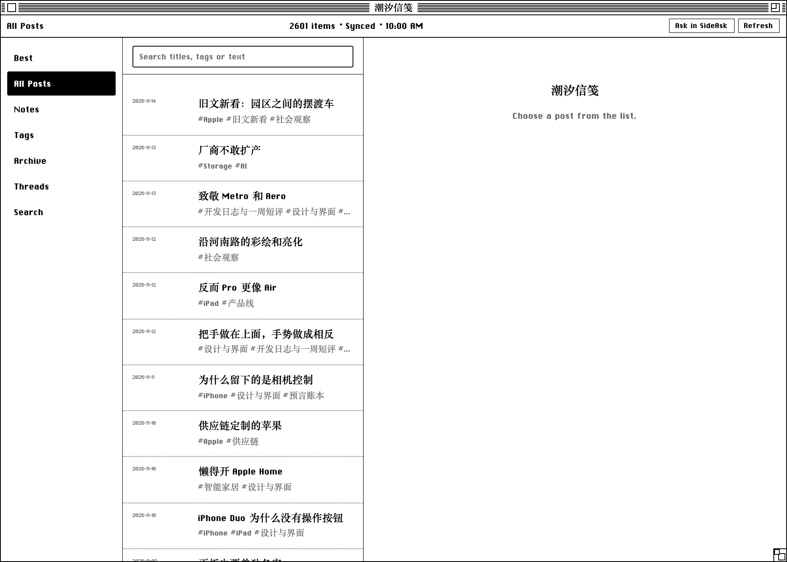
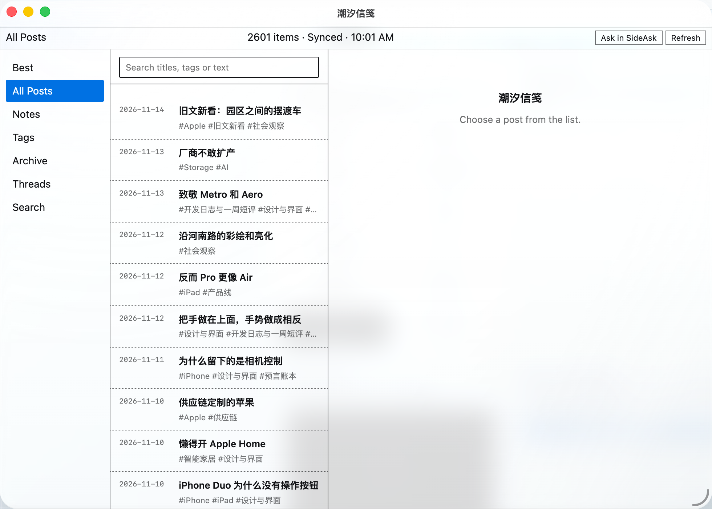

# Tidal Letters（潮汐信笺）

A browser reader for a personal blog’s published JSON pack: posts, notes, tags,
archive, threads and search, with an offline cache of packs already downloaded.
A host page can embed the same files in a frame.

## Screenshots

Captured running inside the AI System 6 desk: Classic on the left, Liquid Glass on the right.

<p> </p>

## Run the demo

```bash
npm start
```

Then open `http://localhost:8080/reader/`.

The `demo/` folder answers `/api/aaron-blog/…` when the page runs on its own
(no host desk). The posts in `demo/` are invented samples about the reader and
about tides and letters; they are not a real blog.

## Real deployment

A host that is not using `demo/` needs a same-origin server that answers:

| Route | Body |
| --- | --- |
| `GET /api/aaron-blog/manifest` | Pack manifest JSON (`contentHash`, optional `rag`) |
| `GET /api/aaron-blog/index` | Index of posts, notes, tags, series, best and longs |
| `GET /api/aaron-blog/search` | Search entries (`{ entries }`) |
| `GET /api/aaron-blog/long` | Long-read HTML pack (`{ posts }`) |
| `GET /api/aaron-blog/chunk/<YYYY>` | Year chunk of post HTML (`{ posts }`) |
| `GET /api/aaron-blog/rag` | Optional RAG pack bytes named by the manifest |
| `GET /api/aaron-blog/retrieve` | Optional SideAsk retrieval over that RAG index |

Without those routes (and without `demo/` or a prior cached pack), the list
stays on the loading empty state.

Progress (last section, selection, downloaded packs) stays in the browser when
the page runs on its own.

## Build

```bash
npm run build
```

Copies what a host page embeds into `dist/` (the app tree without `demo/`).
There are no dependencies; Node is enough.

## Layout

| Path | What it is |
| --- | --- |
| `reader/` | The page, the reader module, its stylesheet, English and Chinese string tables |
| `shared/` | Base styles and the runtime that talks to the bridge |
| `demo/` | Invented sample packs for `npm start` on its own |
| `ais6-bridge.js`, `kit.css`, `app.manifest.json` | Let a host page embed the reader in a frame, keep its progress and draw its menus; on its own page the same calls fall back to local storage |
| `tools/build.mjs` | Copies the embed tree into `dist/` |

## Licence

MIT. See [LICENSE](LICENSE).

中文：[README.zh-CN.md](README.zh-CN.md).
