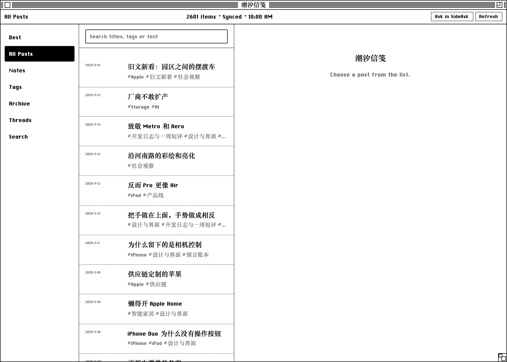
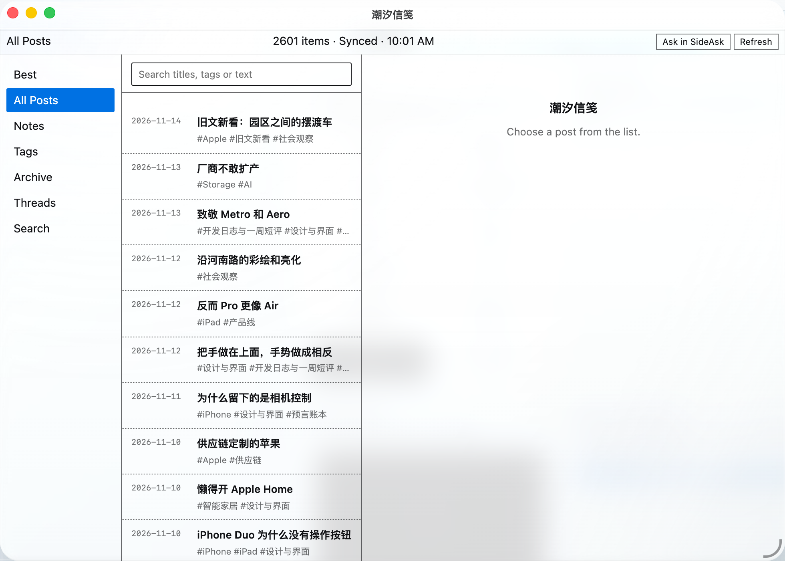

# 潮汐信笺（Tidal Letters）

一个在浏览器里运行的阅读器：读取个人博客发布的 JSON 内容包，按文章、笔记、
标签、归档、线索浏览并搜索，并把已下载的内容包缓存在本机；也可由宿主页面
嵌进窗口。

现在的实作是 TypeScript + Preact：数据模型、内容包的型别守卫与阅读器逻辑
都有单元测试；浏览器测试跑真实页面，包含在搜索框里的中文输入法组合。

## 截图

在 AI System 6 桌面里实际运行时截取，左为 Classic，右为 Liquid Glass。

<p> </p>

## 运行示范

```bash
npm ci
npm run dev
```

然后打开 `http://localhost:5173/reader/index.html`。

单独打开（没有宿主桌面）时，`demo/` 目录会应答 `/api/aaron-blog/…`。
`demo/` 里的文章是虚构样本，写的是阅读器本身，或潮汐与书信的中性填充，
不是真实博客。

## 检查

```bash
npm run check       # 型别（strict）、Biome、单元测试、建置
npm run test:e2e    # 在 Chromium 里跑建置后的页面，含输入法契约
```

## 真实部署

不使用 `demo/` 时，宿主需要提供同源接口：

| 路由 | 内容 |
| --- | --- |
| `GET /api/aaron-blog/manifest` | 内容包清单（`contentHash`，可选 `rag`） |
| `GET /api/aaron-blog/index` | 文章、笔记、标签、线索、精选与长文索引 |
| `GET /api/aaron-blog/search` | 搜索条目（`{ entries }`） |
| `GET /api/aaron-blog/long` | 长文 HTML 包（`{ posts }`） |
| `GET /api/aaron-blog/chunk/<YYYY>` | 按年的文章 HTML（`{ posts }`） |
| `GET /api/aaron-blog/rag` | 可选的 RAG 包（由清单命名） |
| `GET /api/aaron-blog/retrieve` | 可选的检索接口（基于上述 RAG） |

没有这些接口（也没有 `demo/` 或浏览器里先前缓存的内容包）时，列表会停在
「载入中」的空状态。

单独打开时，进度（上次分区、选中篇目、已下载的内容包）留在浏览器里。

## 构建

```bash
npm run build
```

把宿主页面要嵌入的文件写进 `dist/`：清单指名的页面（`reader/index.html`）、
它旁边的 kit 文件，以及一份样式表和一份模块包。`demo/` 不属于嵌入用文件。

## 目录

| 路径 | 内容 |
| --- | --- |
| `reader/index.html` | 清单指名的页面；建置时改写它的模块与样式链接 |
| `src/bridge/` | 带型别的 bridge 客户端：状态、存取闸门、SideAsk、生命周期、菜单 |
| `src/data/` | 内容包的型别、收窄它们的守卫，以及带缓存的内容门 |
| `src/reader/` | 阅读器状态（signals）、纯列表逻辑、文章消毒与引用标记 |
| `src/ui/` | Preact 窗口：状态列、左侧分区、列表栏与文章栏 |
| `src/styles/` | 页面的基础样式与阅读器样式表，都由 1.0.0 原样搬来 |
| `public/` | `ais6-bridge.js`、`kit.css`、`app.manifest.json`，复制到建置根目录 |
| `demo/` | 供单独打开时使用的虚构示范内容包 |
| `tools/probe.mjs`、`tools/compare.mjs` | 对照探针与差异输出 |
| `tests/unit/`、`tests/e2e/` | Vitest、Playwright |

## 变更纪录

### 1.1.0 — 2026-11-22

- 改成 TypeScript + Preact，strict `tsc` 与 Biome 干净。画面、文字、互动、菜单、
  bridge 讯息、储存键（`ui`、`pack:*`）与 `dist` 行为都不变；建置从六份传统脚本
  变成一份模块包。
- 修正：博客发布新的 content hash 之后，阅读器仍在用旧的缓存文章与搜索索引
  （`pack:chunk/*`、`pack:long`、`pack:search`）。现在内容一有变动就作废这些缓存，
  同步一次就能看到新文字，不必重新整理。

## 许可

MIT。见 [LICENSE](LICENSE)。

English: [README.md](README.md).
